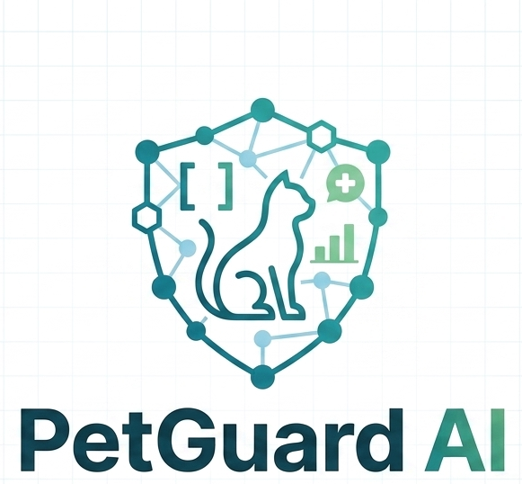

# 🐱 PetGuard AI — B2B AI Module for Smart Pet Care

<p align="center">
  
</p>

<p align="center">
  <b>B2B AI Module สำหรับจำแนกลักษณะและตรวจสุขภาพแมวจากภาพถ่ายอุจจาระ</b><br>
  <i>ให้บริการ AI Model, RESTful API และ SDK สำหรับผู้ผลิตกระบะทรายแมวอัตโนมัติ (Smart Litter Box)</i>
</p>

<p align="center">
  
  
  
  
  
</p>

---

## 📌 Executive Summary (ภาพรวมโปรเจกต์)

**PetGuard AI** เป็นระบบปัญญาประดิษฐ์เชิงพาณิชย์ (B2B AI Solution) ที่ออกแบบมาเพื่อยกระดับอุตสาหกรรม **Pet-Tech** โดยเฉพาะอุปกรณ์ **Smart Cat Litter Box (กระบะทรายแมวอัจฉริยะ)** 

ปัญหาทั่วไปของเจ้าของแมวคือ แมวมักจะซ่อนอาการป่วย และโรคทางเดินอาหารหรือไตมักแสดงอาการผ่านลักษณะอุจจาระและปัสสาวะก่อน PetGuard AI จึงทำหน้าที่เป็น "สัตวแพทย์เฝ้าระวังอัตโนมัติ" คอยตรวจจับ วิเคราะห์ และแจ้งเตือนความผิดปกติแบบ Real-time ทันทีที่แมวขับถ่าย

---

## 🚀 Key Features & Capabilities (ฟีเจอร์เด่น)

1. **AI Image Classification & Segmentation:**
   - จำแนกลักษณะอุจจาระแมวตามมาตรฐาน Feline Stool Scale (FSS) เช่น อุจจาระแข็งปกติ, นิ่มปนเหลว, ท้องเสีย, เลือดปน, หรือพยาธิ
   - ประมวลผลลบพื้นหลัง (Background Removal) และกรองสิ่งรบกวน (ทรายแมว/แสงสะท้อน) เพื่อความแม่นยำสูง
2. **High-Speed B2B API Engine:**
   - ให้บริการผ่าน RESTful API ออกแบบตามสถาปัตยกรรม Microservices
   - Response Time ต่ำ เหมาะสำหรับการส่งข้อมูลจาก Edge Camera ในกระบะทรายแมวขึ้น Cloud ประมวลผล
3. **Health Insight & Diagnostic Confidence:**
   - ส่งผลการวิเคราะห์กลับเป็น JSON พร้อมเปอร์เซ็นต์ความเชื่อมั่น (Confidence Score)
   - มีระบบคำแนะนำเบื้องต้นและการเฝ้าระวังสำหรับสัตวแพทย์และผู้ผลิตแอปมือถือ
4. **Interactive Showcase UI:**
   - หน้า Landing Page และระบบจำลองการส่งภาพทดสอบ (Interactive AI Testing Playground)

---

## 🛠️ Tech Stack & Architecture (เทคโนโลยีที่ใช้)

```
┌─────────────────────────────────┐
│   IoT / Smart Litter Box Camera │
└────────────────┬────────────────┘
                 │ (Capture Image)
                 ▼
┌─────────────────────────────────┐
│     Laravel RESTful API Gateway │  <-- Authentication, Rate Limiting, Logging
└────────────────┬────────────────┘
                 │
                 ▼
┌─────────────────────────────────┐
│   Python AI Inference Engine    │  <-- Preprocessing (remove_bg), PyTorch/YOLO Model
└────────────────┬────────────────┘
                 │ (Inference Result + Health Report)
                 ▼
┌─────────────────────────────────┐
│   Client Mobile App / Webhooks  │  <-- Real-time Health Notification
└─────────────────────────────────┘
```

* **Core AI / Computer Vision:** Python, PyTorch, OpenCV, Image Segmentation
* **Backend & API Gateway:** PHP 8+, Laravel Framework, Clean Architecture
* **Frontend Showcase:** HTML5, Tailwind CSS, Alpine.js, JetBrains Mono & Inter Fonts
* **DevOps & Deployment:** Docker, Nixpacks, GitHub Actions

---

## 📊 Sample API Specification (ตัวอย่างการทำงานของ API)

### `POST /api/v1/analyze-stool`
**Request:**
```http
POST /api/v1/analyze-stool HTTP/1.1
Content-Type: multipart/form-data
Authorization: Bearer <API_TOKEN>

image: [binary_file.jpg]
cat_id: "CAT-8921"
timestamp: "2026-10-12T20:00:00Z"
```

**Response (200 OK):**
```json
{
  "status": "success",
  "data": {
    "cat_id": "CAT-8921",
    "analysis_result": {
      "stool_score": 2,
      "classification": "Optimal / Healthy",
      "confidence": 0.964,
      "abnormal_signs": {
        "blood_detected": false,
        "mucus_detected": false,
        "parasite_detected": false
      }
    },
    "recommendation": "อุจจาระมีสุขภาพดี รูปทรงและเนื้อสัมผัสปกติ ไม่พบสัญญาณผิดปกติ",
    "processed_time_ms": 142
  }
}
```

---

## 🖥️ Live UI Demo Preview

สามารถเปิดไฟล์ [index.html](./index.html) ในเบราว์เซอร์ เพื่อดูหน้า Landing Page เต็มรูปแบบของระบบ พร้อมเอกสารจำลองระบบทดสอบแบบ Interactive

---

## 👤 Developer & Maintainer
* **Developer:** kittinon12548-maker
* **Role:** Lead AI & Full-Stack System Architect
