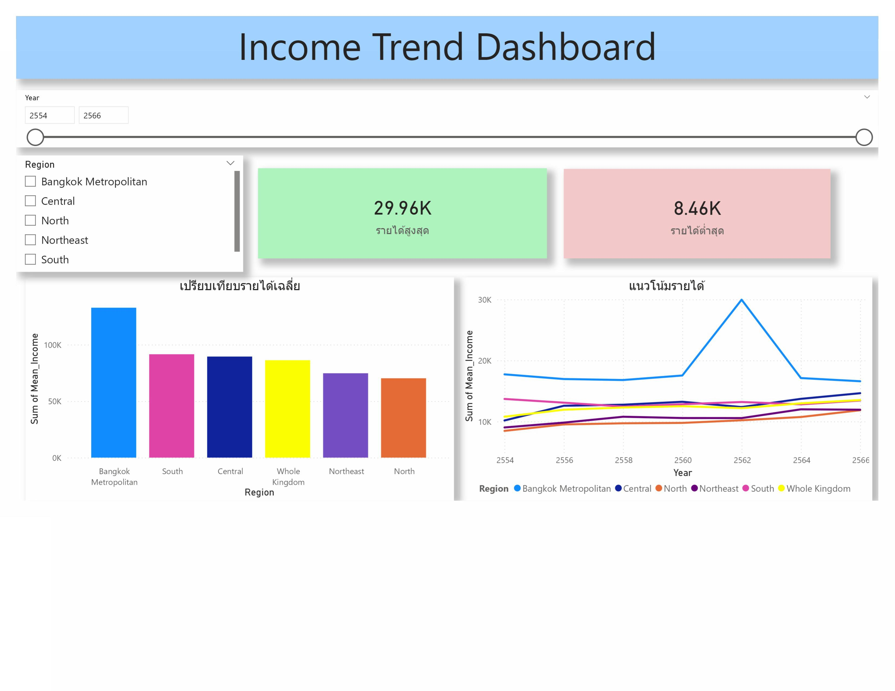
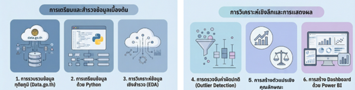

# 📊 การวิเคราะห์ข้อมูลเชิงหลายมิติของรูปแบบและความเหลื่อมล้ำของรายได้ระดับภูมิภาคในประเทศไทย
### A Multidimensional Data Analytics Approach to Regional Income Patterns and Inequality in Thailand

<p align="center">
  
</p>

<p align="center">
  
  
  
  
  
  
</p>

---

## 👨‍🔬 ผู้วิจัยและสังกัด (Authors & Affiliation)
* **นายกิตตินนท์ ชุมบุญ (Kittinon Chumboon)** — นักวิจัยหลัก (First Author)
* **อาจารย์ ดร.สุดา เธียรมนตรี (Dr. Suda Thianmontri)** — ผู้ประพันธ์บรรณกิจ (Corresponding Author: suda@tsu.ac.th)
* **สังกัด:** หลักสูตรวิทยาการคอมพิวเตอร์และสารสนเทศ คณะวิทยาศาสตร์และนวัตกรรมดิจิทัล มหาวิทยาลัยทักษิณ พัทลุง

---

## 📌 ภาพรวมงานวิจัย (Executive Summary)
ความเหลื่อมล้ำทางรายได้ (Income Inequality) เป็นปัญหาสำคัญที่ส่งผลกระทบต่อการพัฒนาเศรษฐกิจและสังคมของประเทศไทย โดยเฉพาะความแตกต่างเชิงพื้นที่ (Regional Disparities) ซึ่งก่อให้เกิดความไม่เท่าเทียมในการเข้าถึงโอกาสทางเศรษฐกิจ 

งานวิจัยนี้ประยุกต์ใช้ **กระบวนการวิเคราะห์ข้อมูลเชิงหลายมิติ (Multidimensional Data Analytics)** ร่วมกับการวิเคราะห์ข้อมูลเชิงสำรวจ (**Exploratory Data Analysis: EDA**) บนชุดข้อมูลเปิดภาครัฐ (Open Government Data) ด้านรายได้เฉลี่ยของครัวเรือนรายเดือนจำแนกตามภูมิภาค ระหว่างปี พ.ศ. 2554 – 2566 จากสำนักงานสถิติแห่งชาติ (data.go.th) โดยผ่านขั้นตอนการตรวจสอบและจัดการค่าผิดปกติ (**Outlier Detection** ด้วย Z-score และ IQR) การสกัดคุณลักษณะเชิงเวลา (**Time-Based Feature Engineering**) คำนวณอัตราการเติบโต และดัชนีวัดความเหลื่อมล้ำ (**Gini Index**) พร้อมพัฒนา **Interactive Dashboard ผ่าน Power BI** เพื่อสนับสนุนการตัดสินใจเชิงนโยบายอย่างมีประสิทธิภาพ

---

## 🎯 วัตถุประสงค์ของการวิจัย (Research Objectives)
1. **สำรวจลักษณะและแนวโน้มรายได้ (Income Trend):** ศึกษาโครงสร้างและแนวโน้มการเปลี่ยนแปลงของรายได้ครัวเรือนในแต่ละภูมิภาคตามช่วงเวลา
2. **วิเคราะห์โครงสร้าง อัตราการเติบโต และความเหลื่อมล้ำ (Disparity & Gini Index):** วิเคราะห์อัตราการขยายตัวทางเศรษฐกิจ (Growth Rate) สัดส่วนรายได้ และประเมินระดับความเหลื่อมล้ำด้วยดัชนีจีนี (Gini Index)
3. **พัฒนาแดชบอร์ดเชิงโต้ตอบ (Interactive Analytics Dashboard):** พัฒนาระบบนำเสนอข้อมูลเชิงภาพ (Data Visualization) ผ่าน Power BI เพื่อช่วยเปรียบเทียบมิติเชิงพื้นที่และสนับสนุนการตัดสินใจ

---

## 🔄 ระเบียบวิธีวิจัยและขั้นตอนการดำเนินงาน (Methodology Pipeline)

<p align="center">
  
  <br><em>รูปที่ 1: แผนภาพกรอบขั้นตอนการดำเนินงานวิจัย (Research Methodology Pipeline)</em>
</p>

1. **การรวบรวมข้อมูล (Data Ingestion):**
   * ข้อมูลทุติยภูมิ (Secondary Data) จากศูนย์กลางข้อมูลเปิดภาครัฐ (*data.go.th*) และสำนักงานสถิติแห่งชาติ (สสช.) ปี พ.ศ. 2554 – 2566
2. **การทำความสะอาดและตรวจสอบข้อมูล (Data Cleaning & Preprocessing):**
   * จัดการค่าสูญหาย (Missing Values) และขจัดข้อมูลซ้ำซ้อน
   * แปลงปี พ.ศ./ค.ศ. และปรับปรุงชื่อตัวแปรให้เป็นมาตรฐาน
3. **การตรวจจับค่าผิดปกติ (Outlier Detection):**
   * ตรวจจับด้วยวิธี **Z-score** (|Z| > 3) ร่วมกับ **Interquartile Range (IQR Rule: Q1 - 1.5*IQR, Q3 + 1.5*IQR)**
   * ประเมินผลกระทบก่อนและหลังตัด Outlier (พบผลกระทบ 9.09% โดยเลือกคงค่าไว้เพื่อสะท้อนความจริงทางเศรษฐกิจที่มีความกระจุกตัวสูง)
4. **การสร้างตัวแปรเชิงคุณลักษณะ (Feature Engineering):**
   * **อัตราการเติบโตของรายได้ (Growth Rate %):** เปอร์เซ็นต์การเปลี่ยนแปลงเทียบกับปีก่อนหน้า
   * **สัดส่วนรายได้ (Income Share %):** โครงสร้างรายได้ประจำ vs รายได้ไม่ประจำ
   * **ดัชนีความเหลื่อมล้ำ (Gini Index):** คำนวณสัมประสิทธิ์ความไม่เสมอภาคของรายได้ระดับภูมิภาคและกลุ่มอาชีพ
5. **การพัฒนาแดชบอร์ดเชิงโต้ตอบ (Interactive Dashboard Design):**
   * พัฒนาผ่าน **Power BI** แบ่งออกเป็นหน้าภาพรวมแนวโน้ม (Income Trend) และการเปรียบเทียบเชิงพื้นที่ (Regional Comparison)

---

## 📈 ผลการวิเคราะห์และข้อค้นพบสำคัญ (Key Findings & Results)

### 1. รายได้เฉลี่ยระดับภูมิภาคและผลกระทบของค่าผิดปกติ (Regional Income & Outliers)
<p align="center">
  
  <br><em>รูปที่ 2: แผนภูมิแสดงรายได้เฉลี่ยรายภูมิภาคและผลกระทบของค่าผิดปกติ</em>
</p>

* **กรุงเทพมหานครและปริมณฑล** มีรายได้เฉลี่ยสูงที่สุดอย่างเด่นชัด (~19,000 – 29,960 บาท/เดือน)
* **ภาคเหนือและภาคตะวันออกเฉียงเหนือ** มีรายได้เฉลี่ยต่ำที่สุด (~8,460 – 10,700 บาท/เดือน)
* สะท้อนถึงปัญหาความเหลื่อมล้ำเชิงพื้นที่ (Spatial Inequality) และการกระจุกตัวของกิจกรรมทางเศรษฐกิจในเมืองหลวง

---

### 2. อัตราการเติบโตของรายได้ (Growth Rate Dynamics)
<p align="center">
  
  <br><em>รูปที่ 3: แผนภูมิแสดงอัตราการเติบโตของรายได้รายภูมิภาคและรายกลุ่มอาชีพ</em>
</p>

* รายได้เฉลี่ยมีอัตราเติบโตสูงสุดในปี **2562** (เฉลี่ยรายภูมิภาคโต 16.39%, กลุ่มอาชีพโต 30.88%)
* เกิดการชะลอตัวและลดลงอย่างมีนัยสำคัญในปี **2564** ซึ่งสอดคล้องกับผลกระทบทางเศรษฐกิจจากวิกฤต COVID-19 ก่อนจะเริ่มฟื้นตัวดีขึ้นในปี **2566**

---

### 3. ดัชนีความเหลื่อมล้ำทางรายได้ (Gini Index Analysis)
<p align="center">
  
  <br><em>รูปที่ 4: แผนภูมิแสดงความเหลื่อมล้ำเฉลี่ยของรายได้รายปีจำแนกตามกลุ่มอาชีพและภูมิภาค</em>
</p>

* เมื่อจำแนกตามภูมิภาค ค่า **Gini Index อยู่ระหว่าง 0.58 – 0.75**
* เมื่อจำแนกตามกลุ่มอาชีพ ค่า **Gini Index อยู่ระหว่าง 0.52 – 0.82**
* ค่าดัชนีสะท้อนถึงระดับความเหลื่อมล้ำทางเศรษฐกิจที่อยู่ในเกณฑ์สูง และรายได้ส่วนใหญ่กว่า 90% มาจาก "รายได้ประจำ" 

---

## 🖥️ ระบบ Interactive Power BI Dashboard
แดชบอร์ดถูกออกแบบตามหลักสถาปัตยกรรมข้อมูลเพื่อการใช้งานจริง (Data Visualization & BI):
* **Income Trend Analysis Panel:** แสดงเส้นแนวโน้มของแต่ละภาค พร้อมตัวกรองเลือกช่วงปี พ.ศ. 2554 – 2566
* **Regional Comparison & Ranking:** แผนภูมิเปรียบเทียบระดับรายได้ อัตราการเติบโต และสัดส่วนโครงสร้างรายได้
* **Inequality KPIs & Gini Metric:** แสดงตัวชี้วัดความเหลื่อมล้ำรายปีและรายภูมิภาคแบบไดนามิก

---

## 📂 โครงสร้างไฟล์ในโฟลเดอร์นี้ (Files in this Project)

```text
02-งานวิจัย มศว/
├── README.md                              # รายละเอียดงานวิจัยและสรุปผลเชิงลึก (Case Study)
├── index.html                             # หน้าเว็บพรีวิว Interactive Showcase สำหรับ GitHub Pages
├── 033-บทความสมบูรณ์-Edited.pdf           # 📄 บทความวิจัยฉบับสมบูรณ์ (Final Accepted Paper PDF)
├── 033-บทความสมบูรณ์-Edited.docx          # 📝 บทความวิจัยฉบับแก้ไขสมบูรณ์ (Word Document)
├── รายได้ครัวเรือน_code.ipynb              # 🐍 โค้ด Jupyter Notebook (EDA, Data Cleaning & Gini Calculation)
├── รายได้ครัวเรือน.pbix                   # 📊 ไฟล์ต้นฉบับ Power BI Dashboard Project
├── bi2.pdf                                # 📑 รายงานหน้าสรุปแดชบอร์ด Power BI (Report PDF)
├── assets/                                # รูปภาพประกอบบทความความละเอียดสูง
│   ├── หน้าbi.jpg                         # ภาพพรีวิวหน้า Power BI Dashboard
│   ├── p1.png                             # รูปที่ 1: ขั้นตอนการดำเนินงานวิจัย
│   ├── p2.jpeg                            # รูปที่ 2: รายได้เฉลี่ยและผลกระทบ Outlier
│   ├── p3.jpeg                            # รูปที่ 3: อัตราการเติบโตของรายได้
│   └── p4.jpeg                            # รูปที่ 4: ความเหลื่อมล้ำ Gini Index
└── data/                                  # ชุดข้อมูลพร้อมใช้งาน (Cleaned & Analyzed Datasets)
    ├── gini_index_dataset.xlsx            # ข้อมูลดัชนี Gini Index
    ├── income_trend_dataset.xlsx          # ข้อมูลแนวโน้มรายได้รายภูมิภาค
    ├── income_structure_dataset.xlsx      # ข้อมูลโครงสร้างและสัดส่วนรายได้
    ├── regional_growth_.xlsx              # ข้อมูลอัตราการเติบโตของรายได้
    └── รายได้เฉลี่ยต่อเดือนของครัวเรือน.xlsx # ข้อมูลดิบต้นฉบับจากสำนักงานสถิติแห่งชาติ
```

---

## 🛠️ เครื่องมือและเทคโนโลยี (Tech Stack)
* **Programming & Analytics:** Python, Pandas, NumPy, Matplotlib
* **Statistical Methods:** Descriptive Statistics, Z-Score Outlier Detection, IQR Method, Gini Coefficient
* **Business Intelligence (BI):** Microsoft Power BI Desktop, DAX, Interactive Data Modeling
* **Data Sources:** Open Government Data Platform (data.go.th), National Statistical Office (NSO Thailand)
